 

<!-- Rendered as an SVG rather than a markdown "#" heading: GitHub draws a rule under every h1.
     Greeting is Slalom blue (#0C62FB); the name is a lighter blue in dark mode and navy in light mode. -->
<picture>
  <source media="(prefers-color-scheme: dark)" srcset="assets/header-dark.svg" />
  
</picture>

 

 

---

 

<!-- A slalom run: gates, a skier and a gondola. Night in dark mode, day in light; regenerate both with `python3 assets/landscape.py`. -->
<picture>
  <source media="(prefers-color-scheme: dark)" srcset="assets/landscape-dark.svg" />
  
</picture>

 

---

 

<picture>
  <source media="(prefers-color-scheme: dark)" srcset="https://raw.githubusercontent.com/asif-jc-slalom/asif-jc-slalom/output/github-contribution-grid-snake-dark.svg" />
  
</picture>

 

---

 

 

---

<!-- align="left"/"right" because GitHub strips CSS; floats are the only way to pin badges to opposite corners. -->

 
